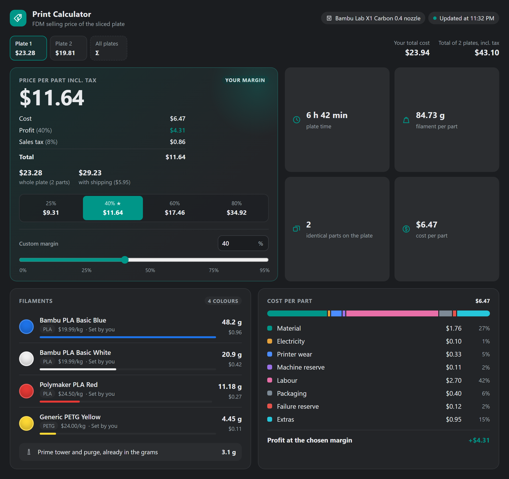
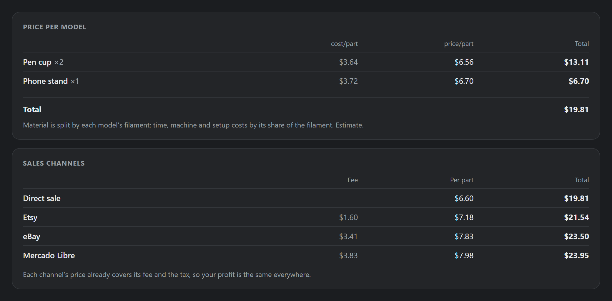
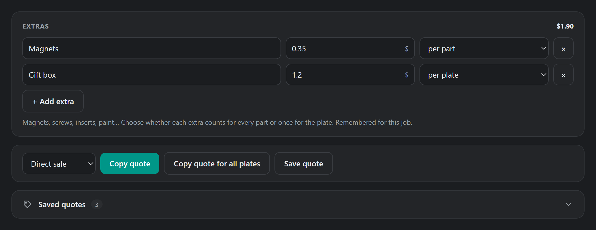
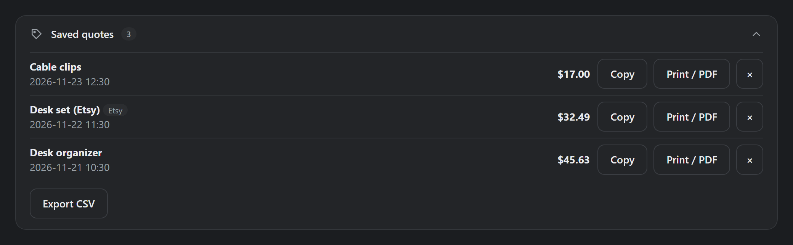
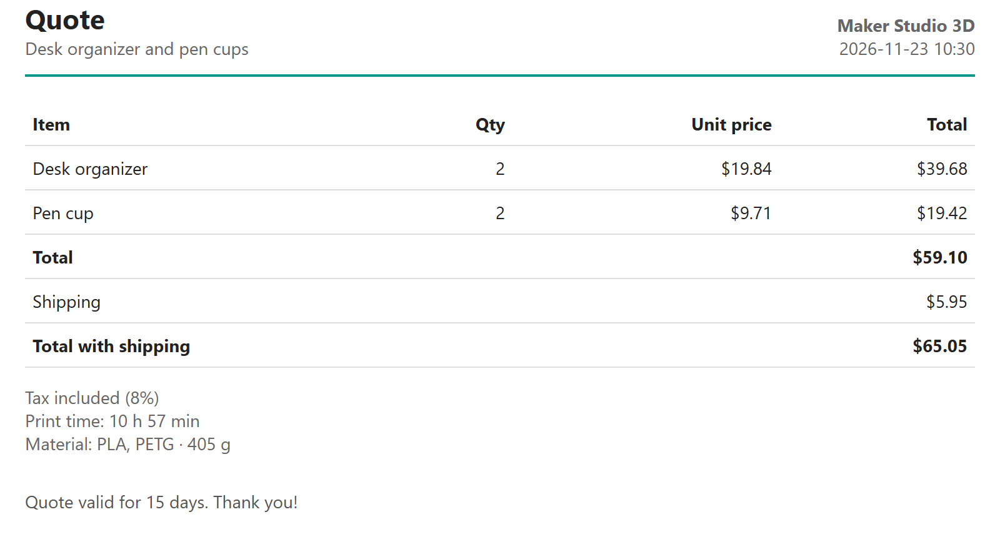
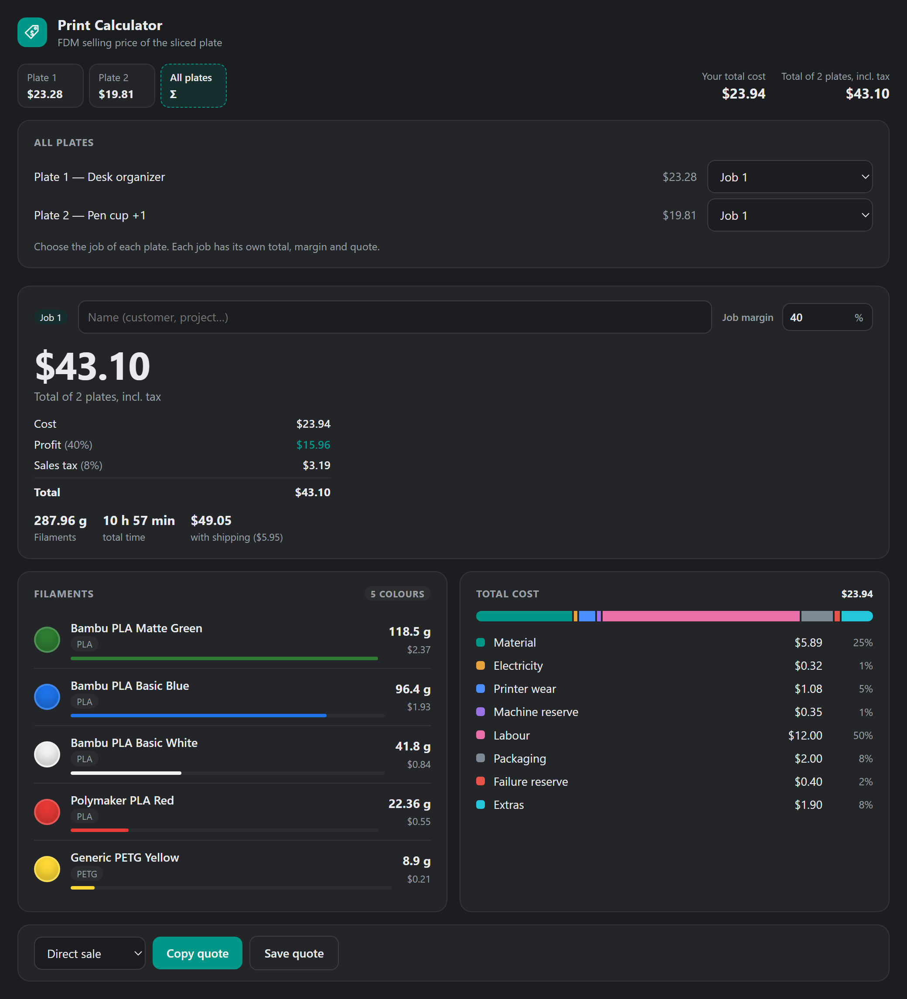
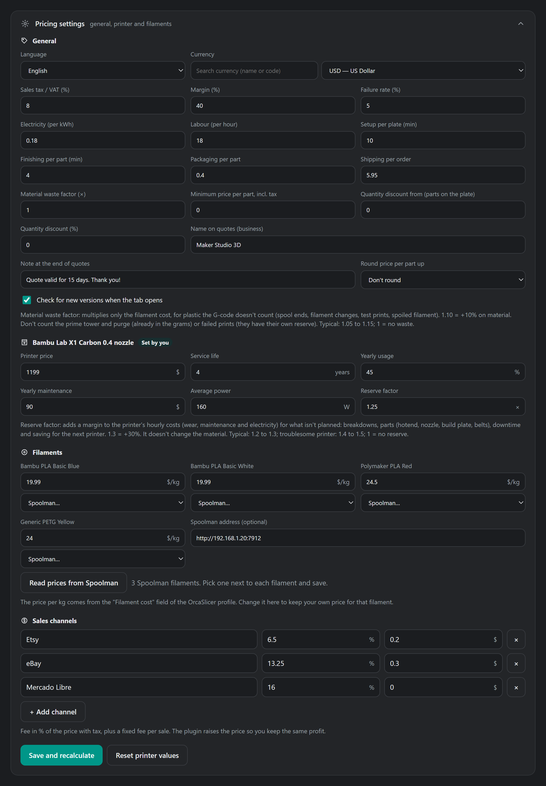
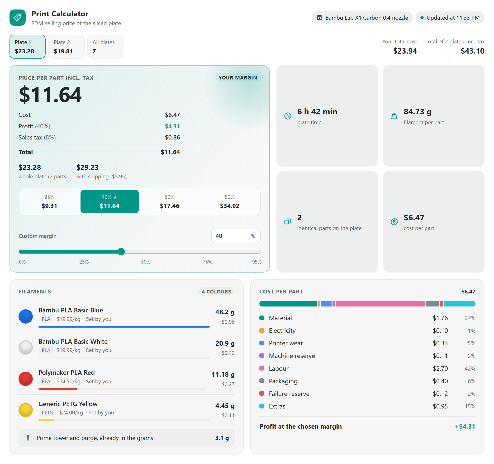

# Print Calculator for OrcaSlicer

**Know what to charge for every plate you slice, without leaving OrcaSlicer.**

Print Calculator adds a tab to OrcaSlicer's top bar. Every time you slice, it reads the G-code and shows the **selling price per part**: material for each colour, electricity, printer wear, a failure reserve, labour, packaging, your margin and tax. For FDM printing.

[Português](README.pt.md) · [Download](https://github.com/Bitrute/print-calculator/releases/latest) · [Report a problem](https://github.com/Bitrute/print-calculator/issues/new)

## Features

- **Updates when you slice.** Nothing to export, nothing to type.
- **Multi-plate projects.** Each sliced plate keeps its own price and margin. Use **Slice all** in OrcaSlicer and every plate shows up, with the total price and your total cost.
- **Multi-colour ready.** Grams and cost of each filament with its colour. The prime tower and purges are already in the grams.
- **Price per model.** Plates with different models get the price of each model, with identical copies grouped.
- **Sales channels.** Add Etsy, eBay, Mercado Libre or your online shop with their fee (% plus a fixed fee per sale). The plugin shows the price on each channel so you keep the same profit after the fee and the tax.
- **Shipping** per order, added to the quote.
- **Extras per part or per plate.** Magnets, screws, paint, a gift box…
- **Quotes.** Copy a ready-to-paste text, or save the quote. Saved quotes print or save as PDF with your business name and a note, and export to CSV (Excel).
- **Jobs.** Group plates into jobs (one per customer or project), each with its own margin, total and quote.
- **Import a sliced file.** Open a `.gcode.3mf` or `.gcode` and price every plate in it without slicing again.
- **Spoolman (optional).** Read the price per kg of your filaments from Spoolman. Read only.
- **Printer cost profiles** from a catalogue of 72 printers, all editable.
- **Pricing rules.** Minimum price, rounding and quantity discount.
- **Any currency** (ISO 4217) and **24 languages**. Light and dark theme follow OrcaSlicer.

## Screenshots

**Price per model and sales channels.** Each channel's price already covers its fee and the tax.

**Extras per part or per plate, and quotes.**

**Saved quotes.** Copy them, print them or save as PDF, or export everything to CSV.

**Printed quote**, with your business name and note.

**All plates and jobs.** Filament per colour and costs of all sliced plates, grouped by job.

**Settings.** General values, the printer's cost profile, filament prices (with Spoolman) and sales channels.

**Light theme.** The tab follows OrcaSlicer's colours.

## Install

### From Orca Cloud (recommended)

1. In OrcaSlicer, open **Plugins** and search for **Print Calculator** by **Bitrute**.
2. Subscribe and enable it. Updates arrive automatically.

### Offline or local install

1. Download `Print-Calculator-<version>.zip` from the [latest release](https://github.com/Bitrute/print-calculator/releases/latest).
2. Close OrcaSlicer.
3. Unzip it and copy the `print_calculator` folder into OrcaSlicer's plugin folder:
   - Windows: `%APPDATA%\OrcaSlicer\orca_plugins\`
   - macOS: `~/Library/Application Support/OrcaSlicer/orca_plugins/`
   - Linux: `~/.config/OrcaSlicer/orca_plugins/`
4. Open OrcaSlicer, enable the plugin in **Plugins** if needed, and open the **Print Calculator** tab.

A local install does not update by itself. The tab tells you when a new version is out; download it again from the releases.

## Getting started

1. Open the **Print Calculator** tab and slice a plate. The first time, OrcaSlicer may ask whether the plugin can read the G-code: choose **Yes**.
2. Confirm your printer and each filament once (price, power, service life…). The price shows up after that.
3. Set tax, margin, electricity and labour in the settings at the bottom of the tab.

**Requirements:** OrcaSlicer 2.5.0 or later, with plugins enabled. FDM only.

## How the price is calculated

- **Material:** grams of each filament × price per kg × waste factor.
- **Electricity:** print time × average power × price per kWh.
- **Printer wear:** printer price ÷ (service life × yearly hours) + yearly maintenance ÷ yearly hours, per hour of printing.
- **Machine reserve:** a margin on the printer's hourly costs for breakdowns and parts (reserve factor).
- **Failure reserve:** covers the prints that fail and must be reprinted.
- **Labour, packaging and extras.**
- **Margin** is on the net selling price (not a markup on cost), then tax, quantity discount, minimum price and rounding.
- **Sales channels:** the price is raised so that, after the channel's fee and the tax, you keep the same as a direct sale.

Tested against the printer profiles of OrcaSlicer 2.5.0: grams, time and part count match the G-code.

## Privacy

No account and no tracking. The plugin only goes online to check the latest version number (can be turned off) and, if you enter its address, to read prices from your Spoolman. It reads the temporary G-code OrcaSlicer writes when slicing and, outside its own folder, only writes files to your Downloads folder when you export a quote or report a problem. Settings and saved quotes are stored by OrcaSlicer and kept when the plugin updates.

## Problems and ideas

Use **Report a problem** at the bottom of the tab: it saves the plate's G-code to a `.zip` in your Downloads folder and opens a [GitHub issue](https://github.com/Bitrute/print-calculator/issues/new) with the versions filled in. Attach the `.zip` so the problem can be reproduced.
