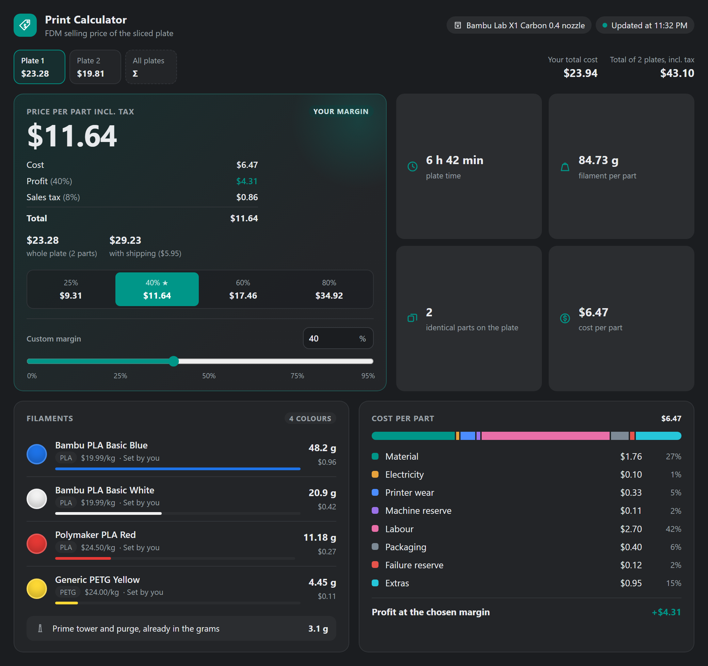
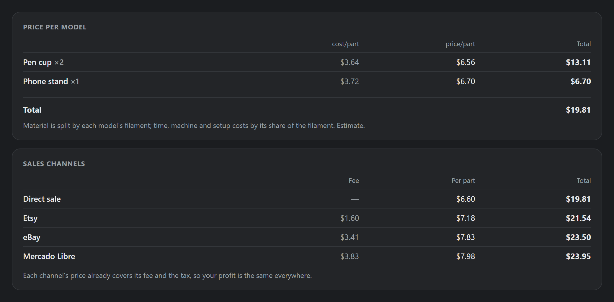
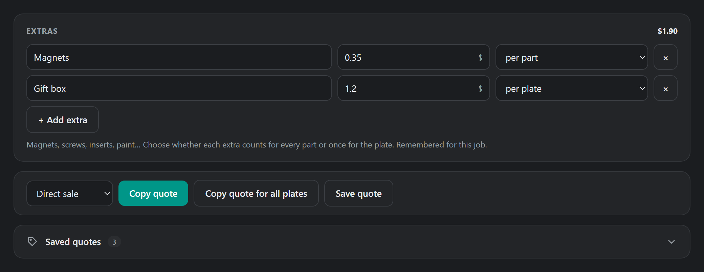
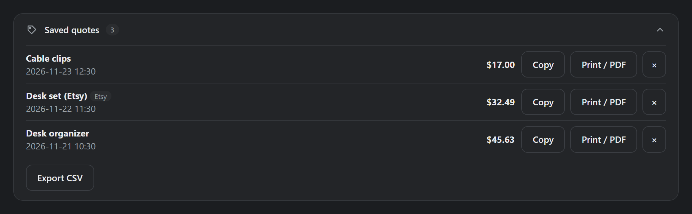
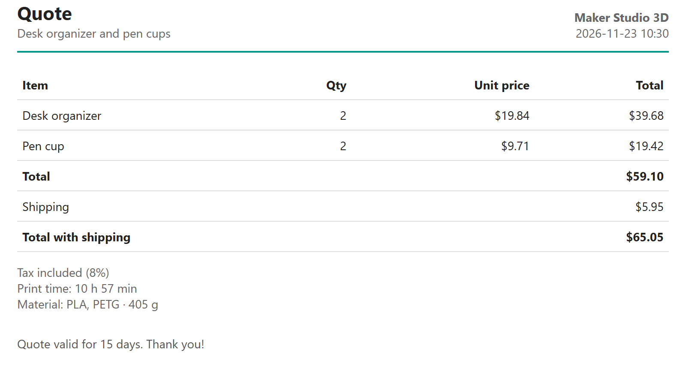
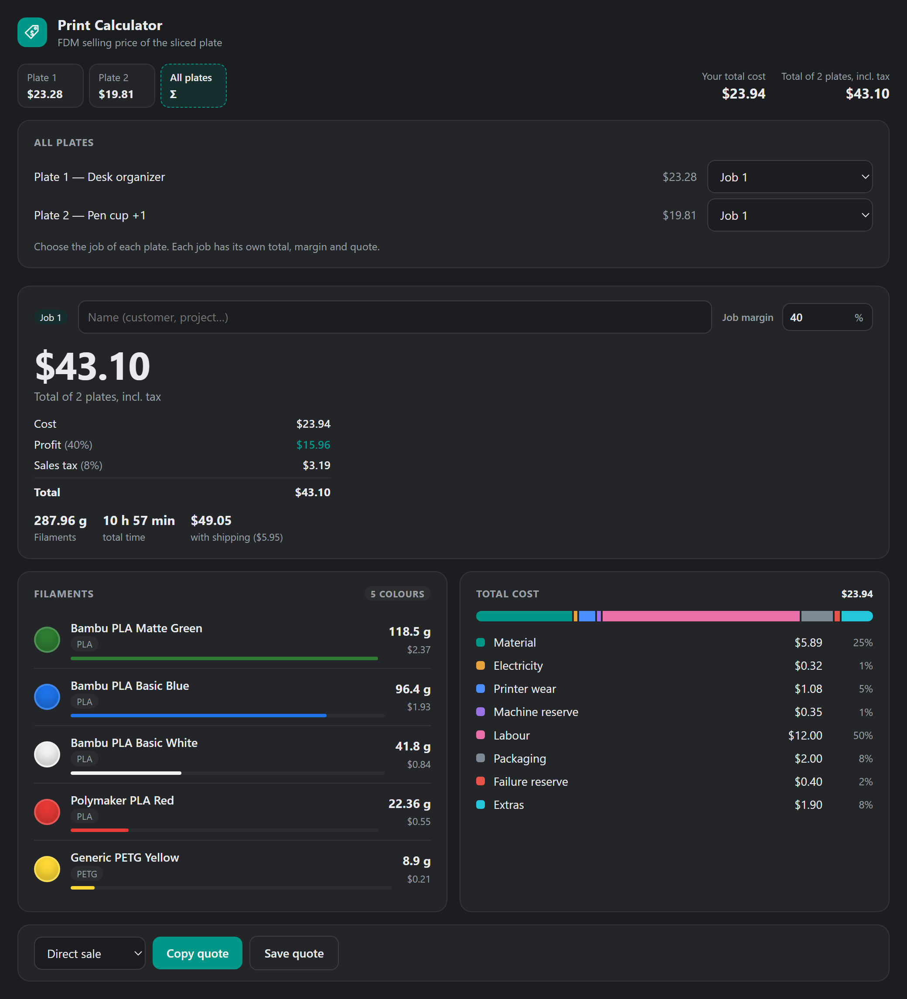
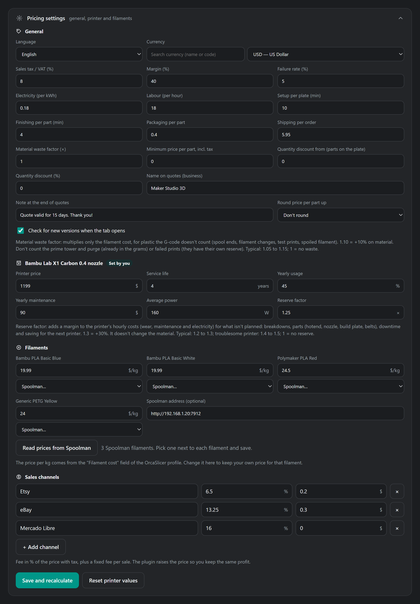
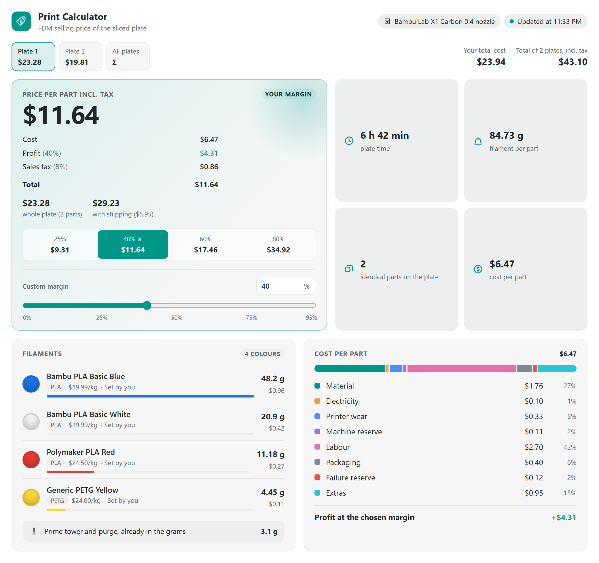

# Print Calculator para o OrcaSlicer

**Sabe quanto cobrar por cada placa que fatias, sem sair do OrcaSlicer.**

O Print Calculator acrescenta um separador à barra de cima do OrcaSlicer. Sempre que fatias, lê o G-code e mostra o **preço de venda por peça**: material de cada cor, eletricidade, desgaste da impressora, reserva para falhas, mão de obra, embalagem, a tua margem e o IVA. Para impressão FDM.

[English](README.md) · [Download](https://github.com/Bitrute/print-calculator/releases/latest) · [Reportar um problema](https://github.com/Bitrute/print-calculator/issues/new)

## O que faz

- **Atualiza quando fatias.** Não há nada para exportar nem para escrever.
- **Projetos com várias placas.** Cada placa fatiada guarda o seu preço e a sua margem. Usa **Fatiar tudo** no OrcaSlicer e todas aparecem, com o preço total e o teu custo total.
- **Pronto para multicor.** Gramas e custo de cada filamento, com a sua cor. A torre de purga e as purgas já estão incluídas nos gramas.
- **Preço por modelo.** Placas com modelos diferentes têm o preço de cada modelo, com as cópias iguais juntas.
- **Canais de venda.** Junta a Etsy, a OLX, o Mercado Libre ou a tua loja online com a taxa (% e taxa fixa por venda). O plugin mostra o preço em cada canal para ficares com o mesmo lucro depois da taxa e do IVA.
- **Portes de envio** por encomenda, somados ao orçamento.
- **Extras por peça ou por placa.** Ímanes, parafusos, tinta, uma caixa…
- **Orçamentos.** Copia o texto pronto a colar ou guarda o orçamento. Os guardados imprimem-se ou guardam-se em PDF com o nome da tua empresa e uma nota, e exportam-se para CSV (Excel).
- **Trabalhos.** Agrupa as placas em trabalhos (um por cliente ou projeto), cada um com margem, total e orçamento.
- **Importar ficheiro fatiado.** Abre um `.gcode.3mf` ou `.gcode` e vê o preço de todas as placas sem fatiar de novo.
- **Spoolman (opcional).** Lê o preço por kg dos teus filamentos no Spoolman. Só leitura.
- **Perfis de custo das impressoras** de um catálogo com 72 impressoras, todos editáveis.
- **Regras de preço.** Preço mínimo, arredondamento e desconto de quantidade.
- **Qualquer moeda** (ISO 4217) e **24 línguas**. Tema claro e escuro como o OrcaSlicer.

## Imagens

**Preço por modelo e canais de venda.** O preço de cada canal já cobre a taxa e o IVA.

**Extras por peça ou por placa, e orçamentos.**

**Orçamentos guardados.** Copia, imprime ou guarda em PDF, ou exporta tudo para CSV.

**Orçamento impresso**, com o nome da tua empresa e a tua nota.

**Todas as placas e trabalhos.** Filamento por cor e custos de todas as placas fatiadas, por trabalho.

**Definições.** Valores gerais, perfil de custos da impressora, preços dos filamentos (com Spoolman) e canais de venda.

**Tema claro.** O separador segue as cores do OrcaSlicer.

## Instalar

### Pelo Orca Cloud (recomendado)

1. No OrcaSlicer, abre **Plugins** e procura **Print Calculator** do **Bitrute**.
2. Subscreve e ativa. As atualizações chegam sozinhas.

### Instalação offline ou local

1. Descarrega o `Print-Calculator-<versão>.zip` da [última versão](https://github.com/Bitrute/print-calculator/releases/latest).
2. Fecha o OrcaSlicer.
3. Descompacta e copia a pasta `print_calculator` para a pasta de plugins do OrcaSlicer:
   - Windows: `%APPDATA%\OrcaSlicer\orca_plugins\`
   - macOS: `~/Library/Application Support/OrcaSlicer/orca_plugins/`
   - Linux: `~/.config/OrcaSlicer/orca_plugins/`
4. Abre o OrcaSlicer, ativa o plugin em **Plugins** se for preciso e abre o separador **Print Calculator**.

Uma instalação local não se atualiza sozinha. O separador avisa quando há uma versão nova; descarrega-a outra vez das versões.

## Como começar

1. Abre o separador **Print Calculator** e fatia uma placa. Na primeira vez, o OrcaSlicer pode perguntar se o plugin pode ler o G-code: escolhe **Sim**.
2. Confirma uma vez a impressora e cada filamento (preço, consumo, vida útil…). Depois disso o preço aparece.
3. Define o IVA, a margem, a eletricidade e a mão de obra nas definições, no fundo do separador.

**Requisitos:** OrcaSlicer 2.5.0 ou mais recente, com os plugins ativos. Só FDM.

## Como o preço é calculado

- **Material:** gramas de cada filamento × preço por kg × fator de perdas.
- **Eletricidade:** tempo de impressão × consumo médio × preço do kWh.
- **Desgaste da impressora:** preço da impressora ÷ (vida útil × horas por ano) + manutenção anual ÷ horas por ano, por hora de impressão.
- **Reserva da máquina:** uma margem sobre os custos por hora da impressora para avarias e peças (fator de reserva).
- **Reserva para falhas:** cobre as impressões que falham e têm de ser repetidas.
- **Mão de obra, embalagem e extras.**
- **Margem** sobre o preço sem IVA (não é acréscimo sobre o custo); depois IVA, desconto de quantidade, preço mínimo e arredondamento.
- **Canais de venda:** o preço sobe para que, depois da taxa do canal e do IVA, fiques com o mesmo que numa venda direta.

Testado com os perfis de impressora do OrcaSlicer 2.5.0: gramas, tempo e número de peças batem certo com o G-code.

## Privacidade

Sem conta e sem recolha de dados. O plugin só usa a internet para ver o número da versão mais recente (pode ser desligado) e, se puseres o endereço, para ler os preços do teu Spoolman. Lê o G-code temporário que o OrcaSlicer cria ao fatiar e, fora da pasta do próprio plugin, só escreve ficheiros nas Transferências, quando exportas um orçamento ou reportas um problema. As definições e os orçamentos guardados ficam no OrcaSlicer e mantêm-se quando o plugin é atualizado.

## Problemas e ideias

Usa **Reportar um problema** no fundo do separador: guarda o G-code da placa num `.zip` nas Transferências e abre um [issue no GitHub](https://github.com/Bitrute/print-calculator/issues/new) com as versões preenchidas. Junta o `.zip` para o problema poder ser reproduzido.
